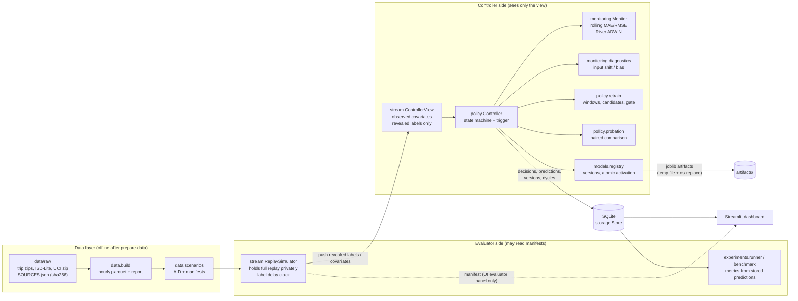
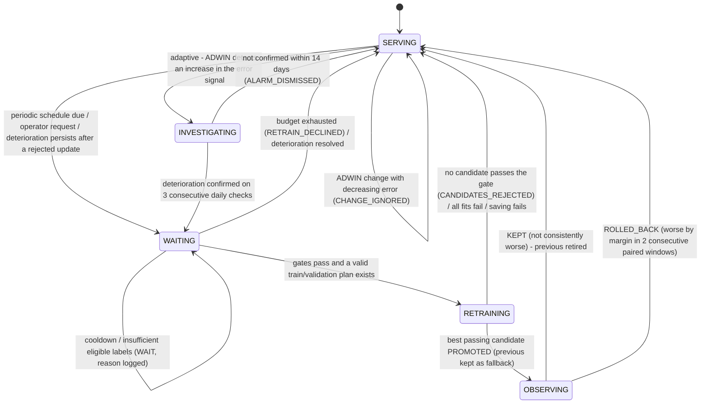

# Architecture

One Python engine (`src/amm`) is shared by the CLI experiments and the Streamlit dashboard.
Policy decisions live in the engine; the UI (`app/dashboard.py`, `amm/ui/live.py`) only calls
`Session.step()` and the logged operator / fault-injection actions, and renders what the
engine recorded.

## Components

The simulator is the only object holding future targets. It *pushes* data into the
`ControllerView`; the view has no reference back to the simulator, the dataframe or the
manifest. `Controller.__init__` has no scenario parameter, the controller-side modules do not
import `amm.data.scenarios`, and a test walks the controller's object graph to check that no
simulator or scenario object is reachable (`tests/test_truth_hidden.py`).

## One replay step (one day, default label delay = 1 batch)

1. `sim.begin_step()` pushes the labels of batch *t - delay* into the view.
2. `controller.on_labels()` scores the *stored* predictions of that batch (never recomputed),
   feeds the active model's errors to the monitor (outage hours excluded from the signal) and
   adds paired outcomes to the probation if one is running.
3. `controller.decide()` runs the state machine (below).
4. `sim.covariates()` exposes batch *t*; the active model predicts each hour (weather lagged
   1 h); during probation the previous model predicts the same rows (shadow). Every prediction
   is stored with model version, prediction step and label-reveal step.
5. A step row (state, rolling metrics, cycles, fits, training seconds) is written. Steps 1-5
   are one SQLite transaction; a non-blocking lock and a duplicate-step check make a repeated
   call (e.g. a Streamlit rerun) a no-op or an error, never a duplicate.

After the last batch, *delay* drain steps reveal the remaining labels, so every prediction is
scored.

## Controller state machine

* **Gates** (shared by periodic and adaptive): per-run budget, a single job at a time,
  cooldown between cycle starts (restarted at rollback), enough eligible labels.
* **Rebasing.** On promotion the monitor is reset and ADWIN is warm-started with the new
  model's validation-window signal; the reference becomes the validation daily median and,
  after probation, the median of validation and live probation evidence. A rollback restores
  the previous model's original reference.
* **Postponement.** A periodic schedule point during probation is postponed, not dropped.

## Data contracts

| Object | Content |
|---|---|
| `predictions` | run, seq, role (`active`/`shadow`), ts, batch, model_version, y_pred, prediction_step, label_reveal_step, y_true, abs_err, scaled_err |
| `decisions` | run, event_id, step, ts, state_from, state_to, action, reason, measurements (JSON), thresholds (JSON), fault_injection |
| `model_versions` | full `ModelVersion` record: model, window, train/validation ranges and seqs, validation metrics, reference, timings, status, activation/retirement steps |
| `candidates`, `cycles` | every fit in every cycle with validation scores and wall time; cycle trigger and outcome |
| `steps` | per-step state and rolling metrics (dashboard, checkpoint checks) |

## Persistence and reload

`Session.save()` pickles the whole session (simulator position, view, controller, models,
ADWIN) with joblib; `Session.load()` reconnects the store and, if the database is ahead of the
checkpoint, deletes the newer rows so the deterministic replay recreates them exactly once
(`tests/test_persistence.py` compares against an uninterrupted run). Model artifacts are
saved with a temp file + `os.replace`; only active and previous artifacts are kept on disk,
metadata of every version stays in SQLite.

## Package map

| Module | Responsibility |
|---|---|
| `data/download.py` | timeouts, retries, cache, checksums, manual fallback |
| `data/trips.py`, `weather.py`, `calendar.py`, `build.py` | hourly table and validation report |
| `data/features.py`, `quality.py` | input contract (leakage), outage rule |
| `data/scenarios.py`, `synthetic.py`, `fallback.py` | scenarios A-D, generator, labelled fallback |
| `stream/simulator.py`, `stream/view.py` | replay clock, information boundary |
| `monitoring/monitor.py`, `diagnostics.py` | ADWIN, rolling metrics, explanations |
| `policy/controller.py`, `evidence.py`, `retrain.py`, `probation.py` | supervisor |
| `models/candidates.py`, `registry.py` | pipelines, versions, atomic activation |
| `storage/store.py` | SQLite schema and idempotent writes |
| `engine.py` | `Session`, initial model, checkpoints |
| `experiments/*` | model selection, calibration, runner, benchmark, charts |
| `ui/live.py`, `app/dashboard.py` | dashboard state and rendering |
